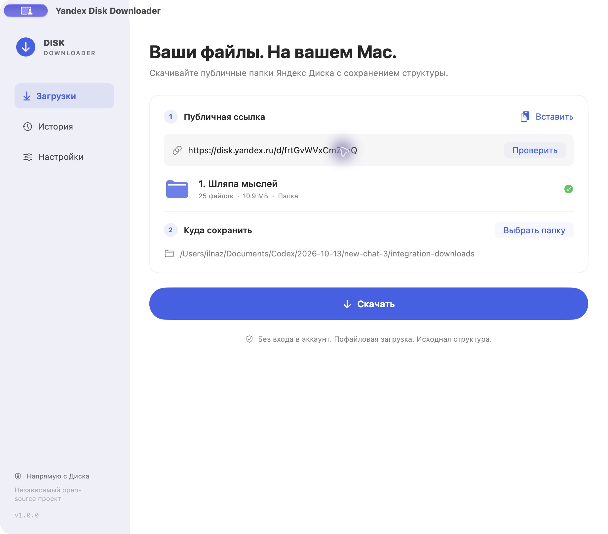

# Yandex Disk Downloader

[](https://github.com/ilonnpng/yandex-disk-downloader/actions/workflows/ci.yml)

**[Download for macOS](https://github.com/ilonnpng/yandex-disk-downloader/releases/latest)** · [Security and build verification](SECURITY.md)

A native macOS app for downloading public Yandex Disk folders and files. Paste a link, choose a folder and download. No Yandex account, API key, Python runtime or terminal is required to use the app.

**macOS 13 Ventura or later · Apple Silicon and Intel · Swift / SwiftUI · MIT**

This is an independent open-source project.
It is not affiliated with or endorsed by Yandex.

## Screenshot



## Features

- Public `disk.yandex.ru/d/…`, `/i/…`, `yadi.sk/d/…`, `/i/…` links and supported Yandex regional Disk domains.
- Recursive folder traversal and paginated API listings, including empty folders.
- Individual file downloads; the app never requests a ZIP archive of a folder.
- 1, 2, 3, 5 or 8 parallel downloads (default 3).
- Actual byte progress, file counts, transfer speed and estimated time remaining.
- Pause, resume and cancellation. Completed files are preserved.
- Failed files are skipped immediately so the queue can continue; retry them with **Retry Failed Downloads** after completion. Metadata inspection uses limited retries with exponential backoff. HTTP 429 creates a shared API cooldown respecting `Retry-After`.
- Each new attempt requests a fresh download link. A rejected partial resume is reported as a failed file and can be retried from the beginning.
- Size and SHA-256 / MD5 verification when the API provides them.
- Existing files are never overwritten: matching files can be skipped; other collisions receive numbered names.
- Persistent settings and the latest 200 history entries.
- System, light and dark appearances; English and Russian interface.
- Optional completion notifications and Finder opening.

## Install

1. Download the application ZIP from [GitHub Releases](https://github.com/ilonnpng/yandex-disk-downloader/releases/latest) and unzip it. The separate Source code archives are for building the app yourself.
2. Drag **Yandex Disk Downloader.app** to Applications (or open it from the extracted folder).
3. Paste a public Yandex Disk link, wait for inspection, choose the destination and click **Download**.

The supplied local build is ad-hoc signed, not Apple-notarized. macOS may ask you to approve opening it using its standard Open / Privacy & Security controls. We do not recommend disabling Gatekeeper. For trusted distribution, maintainers should sign with Developer ID and notarize through Apple.

No paid Apple Developer account is needed for local builds.

**По-русски:** скачайте ZIP приложения в разделе [Releases](https://github.com/ilonnpng/yandex-disk-downloader/releases/latest), распакуйте и перенесите приложение в «Программы». Вставьте публичную ссылку Яндекс Диска, выберите папку и нажмите «Скачать». Если файл завершился с ошибкой, приложение пропустит его и продолжит очередь; затем можно повторить неудачные загрузки.

Release archives are built from the published version tag by GitHub Actions. Each release includes SHA-256 checksums, build information and a provenance attestation. See [SECURITY.md](SECURITY.md) for verification instructions and the limits of these checks.

## Build with Xcode

Open `YandexDiskDownloader.xcodeproj`, choose the **YandexDiskDownloader** scheme and run. The project contains the app, a static core library and a hostless XCTest target. It has no external packages. Use a current Xcode with Swift 5.9 or later.

```sh
xcodebuild -project YandexDiskDownloader.xcodeproj \
  -scheme YandexDiskDownloader -configuration Release build
xcodebuild -project YandexDiskDownloader.xcodeproj \
  -scheme YandexDiskDownloader -destination 'platform=macOS' test
```

## Build without full Xcode

Apple Command Line Tools with a compatible Swift toolchain are sufficient:

```sh
./Scripts/build-app.sh
```

This creates a universal `dist/Yandex Disk Downloader.app` for arm64 and x86_64. For a faster build on Apple Silicon:

```sh
ARCHS=arm64 ./Scripts/build-app.sh
```

To create a disk image, where macOS allows disk-image creation:

```sh
./Scripts/make-dmg.sh
```

The committed icon and Xcode project are ready to use. `Scripts/generate-xcode-project.py` is only a maintainer convenience for regenerating the project; Python is not required to build or use the app.

## Tests

```sh
./Scripts/test.sh
```

The suite uses XCTest when full Xcode is selected. Command Line Tools distributions without XCTest use Swift Testing wrappers around the same scenarios. Mock `URLProtocol` responses isolate the tests from Yandex availability. The Swift Testing fallback requires a toolchain shipping Testing.framework and a supported host OS; the app itself still targets macOS 13.

See [validation report](docs/VALIDATION.md) for the exact checks performed on this build and the checks that could not be performed.

## How it works

`DiskAPI` uses Yandex's public REST endpoints directly:

- `GET https://cloud-api.yandex.net/v1/disk/public/resources`
- `GET https://cloud-api.yandex.net/v1/disk/public/resources/download`

`public_key`, `path`, `limit` and `offset` are encoded using `URLComponents`. A serially paced API client enumerates metadata; a bounded task group downloads files using `URLSessionDownloadTask`. Public metadata is fetched without OAuth. The Yandex API provides each file's temporary HTTPS download URL.

Source reference: [Yandex Disk REST API](https://yandex.ru/dev/disk/rest), [Yandex public resource SDK implementation](https://github.com/yandex-disk/yandex-disk-restapi-java/blob/master/disk-restapi-sdk/src/main/java/com/yandex/disk/rest/RestClient.java).

## Project structure

```text
Sources/YandexDiskCore/         API, recursive scanner, transfers, filesystem safety
Sources/YandexDiskDownloader/   SwiftUI views and MainActor view model
Tests/YandexDiskCoreTests/      Mock network, parsing and filesystem tests
Resources/                     Info.plist, icon and optional sandbox entitlements
Scripts/                       Build, test, packaging and project maintenance
```

The MVVM view model owns each run, persisted preferences and history. Core logic stays independent of SwiftUI. File hashes and disk writes run off the main actor.

## Filesystem safety and privacy

The destination is selected using `NSOpenPanel`. Sandboxed builds save and resolve security-scoped bookmarks; ordinary builds retain the selected local path. Default builds are not App Sandbox builds; optional `SANDBOX=1 ./Scripts/build-app.sh` adds the included sandbox entitlements and requires separate release QA.

Writes use pinned directory descriptors, `openat` with `O_NOFOLLOW`, exclusive staging files and atomic `linkat` publication. Relative parent traversal, symlink traversal and unsupported names are rejected. Case / Unicode collisions in the remote listing receive unique numbered local names. Original API paths remain unchanged. No file is overwritten.

There is no telemetry or third-party backend. Network traffic goes to Yandex's public API and the download endpoints it supplies. Temporary download URLs are not logged or saved in history. Public source links and local destination paths are stored locally in UserDefaults to support repeating downloads. Removing a history entry does not delete downloaded files.

## Limits

- Yandex download restrictions, deleted links, passwords or access restrictions remain in force; the app does not bypass them.
- Pausing cancels current transfers while retaining `resumeData` in memory when URLSession supplies it. Resuming reacquires a download link. Servers may reject resume data; the file is skipped and can be retried manually. Completed files are not fetched again when skipping is enabled.
- Transfers with no byte progress for 45 seconds fail and leave the queue. After a download-task timeout, later files and manual retries use a URLSession data-task fallback that streams to disk in small chunks; this fallback restarts an incomplete file after pausing.
- Partial transfers are not restored after quitting or a crash. Repeat a history entry to verify and skip completed files.
- Filesystem copying / checksum verification already in progress may finish after Pause or Cancel; network scheduling stops. Temporary system download files may remain after an abrupt process termination.
- ETA is an estimate and is hidden when the total size is unknown or the transfer is paused.
- Local names containing `:`, `\\` or control characters are normalized with underscores; long names are shortened with a stable hash. Case/Unicode collisions receive numbers. A warning lists each adjustment. Traversal names and overly deep paths are skipped and reported.
- Download staging uses the macOS temporary directory and copies to the destination, so available space is needed on both volumes. The app reports disk errors rather than reserving space in advance.
- Unavailable nested folders are skipped with a visible warning; inspect the public link again to retry those folders. The file retry button only retries files already discovered.
- A changing remote folder can invalidate pagination; inspect again. The source is not a transactional snapshot.
- Notification permission is requested only if notifications are enabled and a download completes.
- Some technical error explanations are English in both interface languages.

## Contribute

See [CONTRIBUTING.md](CONTRIBUTING.md) and [CHANGELOG.md](CHANGELOG.md). Please do not attach private links, signed download URLs or personal files to bug reports.
